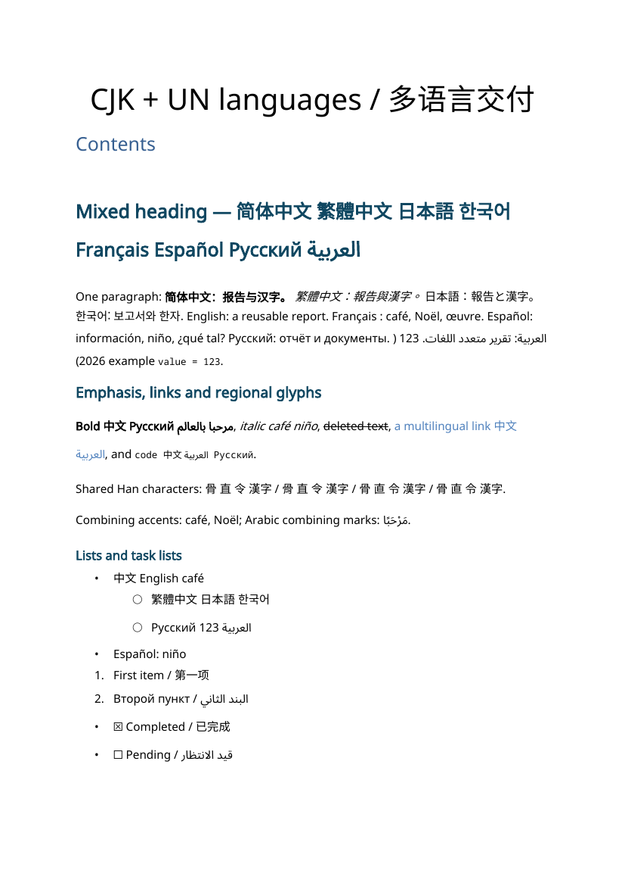

# markdown2docx

[中文](README_zh.md) | English

Convert Markdown into an editable Word document containing **Simplified Chinese, Traditional Chinese, Japanese, Korean, English, French, Spanish, Russian and Arabic in the same file**. Mixing works within headings, paragraphs, links, tables, notes and code; you do not need a template.

The converter preserves Pandoc's document structure and assigns verified open fonts to text fragments. Arabic paragraphs and mixed RTL/LTR text receive explicit direction properties. It does not translate your text.

## Quick start

Requires Python 3.14+ and Pandoc. CI tests against Pandoc 3.12; older versions are not covered by the new mixed-language acceptance suite.

```bash
# macOS: brew install pandoc
# Debian/Ubuntu: sudo apt-get install pandoc
# Windows: install Pandoc from https://pandoc.org/installing.html
uv sync
uv run markdown2docx examples/multilingual.md -o report.docx --toc --json
uv run markdown2docx --doctor --json
```

The existing Unix setup script can install dependencies and Pandoc. It may use a system package manager. Conversion itself never installs Pandoc or system fonts.

For an installed package, use the `markdown2docx` entry point or `python -m markdown2docx.cli`. The 0.2.0 changes in this branch are not a claim that a PyPI release is already available.

## One file, multiple languages

[The comprehensive fixture](examples/multilingual.md) includes all supported languages, combining accents, Arabic marks, lists, tasks, tables, quotations, links, an image, highlighted code, footnotes, a TOC and equations. It includes all languages in one paragraph and one table cell. See the generated [DOCX](examples/output/multilingual.docx), [PDF](examples/output/preview/preview.pdf) and [check report](examples/output/report.json).



The TOC is a Word field; refresh it in Word/LibreOffice to populate entries. Headless previews may show only its heading.

```markdown
---
lang: en
---

**[简体中文]{lang=zh-Hans}** [繁體中文]{lang=zh-Hant}
[日本語の漢字]{lang=ja} [한국어]{lang=ko}
[English]{lang=en} [Français : café]{lang=fr}
[Español: niño]{lang=es} [Русский]{lang=ru} [العربية]{lang=ar} 123.

::: {lang=ar dir=rtl}
مرحبا بالعالم مع [English 中文 123 (https://example.com)]{dir=ltr}.
:::
```

Ordinary mixing does not require per-word language tags: Unicode scripts select fonts automatically. Shared Han characters cannot reliably identify the intended Chinese/Japanese/Korean regional glyphs. Specify local `lang` for those passages; otherwise paragraph context and the main language are used, with Simplified Chinese as the ambiguous fallback and an explicit warning.

Use BCP 47 tags, including regional variants such as `en-GB`, `fr-CA`, `zh-TW`. Language settings take precedence in this order: CLI/API, Markdown metadata, environment, config file, defaults. Local spans/divs override their own passages. Without explicit direction, paragraphs use their first strong prose character; inline code is excluded. Code blocks remain LTR. `--ui-lang zh` changes CLI messages, not the document.

## Fonts and viewing requirements

Defaults use approved builds of Noto Sans, regional Noto Sans CJK, Noto Sans Arabic, Noto Sans Mono, Noto Sans Math and Noto Sans Symbols2. The [font manifest](src/markdown2docx/font_manifest.json) records immutable official source revisions, checksums and license checksums. Noto's [official documentation](https://notofonts.github.io/noto-docs/website/use/) describes its OFL commercial-use terms.

Selection order is **exact verified system build → verified application cache → download the pinned official build**. Matching a family name alone is insufficient. Font downloads retain their license files, check SHA-256 before publication and use a cache lock. Only required fonts are fetched; supporting every CJK region needs several large font files.

- Fonts are referenced, not embedded. Cached fonts are **not installed** and are not automatically visible to Word or LibreOffice. Install the reported font files on viewing machines to avoid substitution.
- `--offline` disables downloads. Missing or corrupt required fonts produce an actionable error rather than an unknown-font fallback.
- Unrecognized explicit config/template fonts are rejected. `--allow-unverified-fonts` permits installed fonts only as an explicit exception; reports retain the license warning.
- The default cache is `~/Library/Caches/markdown2docx/fonts` on macOS, `%LOCALAPPDATA%/markdown2docx/fonts` on Windows, and `$XDG_CACHE_HOME/markdown2docx/fonts` or `~/.cache/markdown2docx/fonts` on Linux.
- Exact pagination depends on the viewing application and installed fonts. Color emoji are not verified; raw Markdown HTML/raw content is outside full integrity checking. Their report statuses reflect these limitations.

## CLI and reports

```bash
uv run markdown2docx input.md --json --lang fr --direction auto
uv run markdown2docx input.md --ui-lang zh --offline
uv run markdown2docx input.md --template company.docx --toc
uv run markdown2docx input.md --render --preview-dir previews --json
uv run markdown2docx --create-template reference.docx --json
```

`--json` conversion output contains `status`, `output_path`, `language`, `languages`, `scripts`, `fonts`, `warnings`, `checks` and `preview`. Font records include file paths, source (`system` or `cache`), checksums, license provenance, weight and style. Diagnostics and template creation also support JSON; logs go to stderr. Help/version retain conventional CLI output.

Errors return a nonzero exit code and stable JSON codes including `FONT_UNAVAILABLE`, `FONT_CHECKSUM_FAILED`, `FONT_DOWNLOAD_FAILED`, `FONT_GLYPH_MISSING`, `FONT_LICENSE_UNVERIFIED`, `TEMPLATE_INVALID`, `INVALID_ARGUMENT` and `VALIDATION_FAILED`.

Required structure, text-integrity, font-coverage and language/direction checks run before atomic publication. `--no-validate` / `validate_output=False` remain accepted for compatibility but do not disable these required checks. Failed conversion or validation preserves the existing destination.

`--render` is optional. LibreOffice and `pdftoppm` provide PDF/page previews when fonts are installed; cached fonts, missing tools and failures are explicitly reported. `rendered` means a preview was generated, **not that a human approved its appearance**. Preview files are created only when rendering is possible.

## Python API and configuration

```python
from markdown2docx import MarkdownToDocxConverter

converter = MarkdownToDocxConverter()
path = converter.convert("input.md", "output.docx")  # still returns Path
report = converter.convert_with_report("input.md", lang="en", toc=True)
print(report.to_dict())
```

YAML/TOML configuration:

```toml
[international]
lang = "en"
direction = "auto"
offline = false
allow_unverified_fonts = false
# font_cache = "/your/private/cache"

[template]
page_size = "A4"
margin_cm = 2.54
body_font = "Noto Sans"
heading_font = "Noto Sans"
code_font = "Noto Sans Mono"
body_size_pt = 11
code_size_pt = 9
```

Pass `--config config.toml`. Environment overrides use `MD2DOCX_INTERNATIONAL__LANG`, `MD2DOCX_INTERNATIONAL__OFFLINE`, etc. Explicit body/heading/code font configuration affects Latin text; script-specific open fonts cover CJK and Arabic. User templates provide layout and styles, while the conversion pipeline assigns fonts for language coverage. Missing or corrupt templates fail instead of silently being ignored.

Output publication rejects symlinks/reparse points. POSIX publication pins directory descriptors; Windows pins directory handles without delete sharing. Publication fails closed when the necessary secure operations are unavailable.

## Agent skill

[markdown-to-docx](skills/markdown-to-docx/SKILL.md) includes a self-contained launcher that runs the execution package at an immutable Git commit via `uv tool run` (`uvx`); it does not need a local checkout. It requires `uv`, Pandoc and network access for first-time package/font acquisition.

After this branch is merged, install with:

```bash
npx skills add cnkang/markdown2docx --skill markdown-to-docx
```

## Validation and CI artifacts

```bash
uv sync --locked --group dev --group test
uv run python scripts/prepare_fonts.py
make quality
uv run pytest
uv run mypy src/markdown2docx
uv run python scripts/validate_multilingual.py --offline --output-dir artifacts/multilingual
# After installing the required fonts and rendering tools:
uv run python scripts/validate_multilingual.py --offline --render --output-dir artifacts/multilingual
```

GitHub Actions converts and checks the fixture on Linux, macOS and Windows. The disposable Linux runner installs the verified fixture fonts, renders with LibreOffice, and checks that expected CJK/Arabic/Latin fonts appear in the PDF. Required `evidence-<OS>` artifacts contain the DOCX, JSON report, JUnit, coverage and distributions; optional `preview-<OS>` artifacts contain Linux page previews. Rendering still requires visual review, particularly Arabic joining, punctuation and page breaks. Manual Word/LibreOffice checks remain a release gate; configured CI is not evidence that all platforms already passed.

See [examples](examples/README.md) and the [0.2.0 migration notes](CHANGELOG.md).

## License

Project code: MIT. Downloaded fonts retain their own OFL licenses; they are not relicensed as MIT.

## Reliability, resource boundaries and development checks

Explicit missing configuration files, unknown keys, wrong types and out-of-range values fail before conversion. Each converter owns a configuration snapshot. `pandoc.timeout_seconds` applies separately to parsing, reference extraction and DOCX writing; timeouts return `PANDOC_TIMEOUT` and preserve existing DOCX output. Font download reads use 60-second timeouts and cache locks wait up to 120 seconds. LibreOffice and rasterization each have 120-second timeouts. There is currently no shared end-to-end deadline.

`--offline` disables **font** downloads only; it does not restrict document resources. `--resources-offline` rejects remote images. `--restricted` also limits local images to the input document directory, stages their bytes privately, and rejects raw content and arbitrary filter/defaults options. Font offline and resource offline are independent policies and may be configured separately.

For Markdown from an untrusted source, use `--untrusted`, `converter.convert_untrusted(...)`, `converter.convert_untrusted_with_report(...)`, or the package-level `convert_untrusted(...)` / `convert_untrusted_with_report(...)` helpers:

```bash
uv run markdown2docx input.md --untrusted --json
```

```python
from markdown2docx import convert_untrusted_with_report

report = convert_untrusted_with_report("input.md", "output.docx")
```

The untrusted entry point always forces `restricted=True`, `resources_offline=True` and `offline=True`; caller arguments or configuration cannot weaken these settings. Policy failures return exit code 1 and a stable JSON `CONVERSION_FAILED` error under `--json`, without publishing a DOCX. Ordinary `convert()` / `convert_with_report()` retain their trusted-caller semantics, including explicit Pandoc extensions. This policy does not replace an operating-system sandbox; Windows image staging still relies on the caller trusting its local directories. Reserved format/output/template arguments cannot override any conversion pipeline.

The `[limits]` section supports `input_bytes` (64 MiB), `archive_bytes` (512 MiB), `archive_entries` (10000), `xml_bytes` (64 MiB), and `preview_pages` (200). Exceeding a limit fails explicitly without truncating content. `conversion.create_backup=true` is unsupported and now fails explicitly; retain historical copies separately. `logging.file_path` configures a CLI log file. Required integrity checks always run.

All CLI modes share one conversion flow. Quiet mode suppresses success and INFO output; JSON stdout contains only the result. CLI templates are content-free by default; use `--template-sample` to include examples. Reports add `schema_version`, `conversion_id`, `timings` and `tools`; see the [JSON schema](src/markdown2docx/report_schema.json). Previews use immutable `generation-*` directories and numeric page ordering. Failures preserve previous previews; consume paths from the report and apply your own retention policy to old generations.

Development uses the uv lockfile, Ruff, mypy, pytest and Bandit. `make quality`, pre-commit and CI share tool versions and scopes; CI also runs actionlint v1.7.7. Prepare verified fonts with `scripts/prepare_fonts.py` before tests. In-process Python downloads must be mocked explicitly; CLI subprocess tests also require the prepared font cache. Default pytest does not generate coverage artifacts; CI collects branch coverage separately. `scripts/benchmark_conversion.py` records repeated segmentation and stage timing medians.

CI verifies Pandoc archive SHA-256 and tests a built wheel outside the source checkout on all three platforms. Required JUnit, coverage, multilingual, distribution and skill-smoke artifacts fail closed when missing; page previews remain optional. `Publish distribution` is a manual workflow: dispatch it on a reviewed `vX.Y.Z` tag containing the workflow, and supply that same tag. The release first calls the same reusable `Test` workflow at the dispatch commit; `build` waits for quality, the real Agent skill smoke and the Linux/macOS/Windows test matrix, then builds and validates the wheel and sdist before `publish`. Configure release environments, required approval and PyPI Trusted Publishing first; rehearse on TestPyPI before selecting PyPI. Publication uses OIDC and provenance attestations. This change does not publish packages automatically. The Agent execution pin is an immutable reviewed remediation commit: the already-reviewed, security-hardened remote baseline `bac6731231a38f9873fd1dfeba02ce1c8a448a76`. This change keeps that pre-merge baseline; update the pin only in a post-merge follow-up commit after the later execution commit is published and tested.
